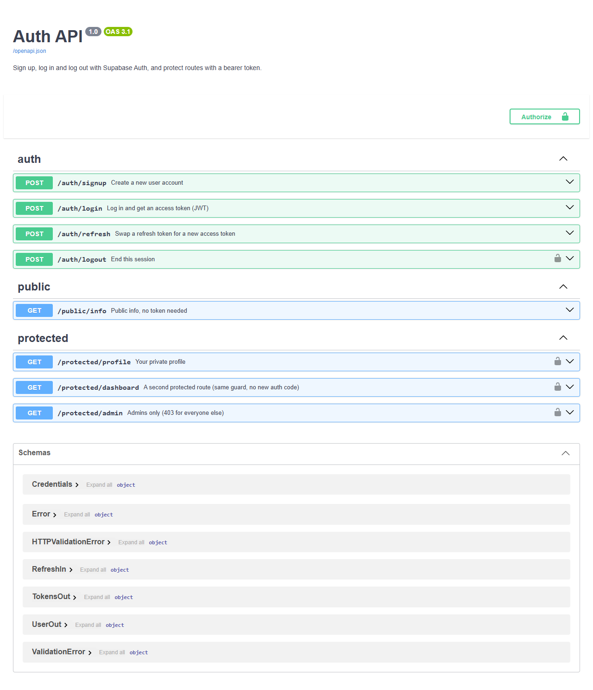

<a name="readme-top"></a>

[](https://www.linkedin.com/in/azizulabedin/)
[](https://github.com/azizulabedinazmi)
[](https://azizulabedinazmi.netlify.app/)
[](https://internship.flyrank.ai/verify?id=FR-D1-A84A9-AB526&first_name=Azizul)
[](https://www.python.org/)
[](https://fastapi.tiangolo.com/)
[](https://supabase.com/docs/guides/auth)

<div align="center">
  <h3>Auth API: Login &amp; Protect</h3>
  <p>
    A FastAPI service that signs users up, logs them in and out with <b>Supabase Auth</b>, and guards private routes
    with a <b>JWT bearer token</b> checked by one reusable dependency. Documented in Swagger UI with a working Authorize padlock.
    <br /><br />
    FlyRank AI Internship · Backend AI Engineering · BE-03 / A4 (Auth: Login &amp; protect) · Python lane
  </p>
</div>

<details>
  <summary>Table of Contents</summary>
  <ol>
    <li><a href="#how-it-works">How It Works</a></li>
    <li><a href="#getting-started">Getting Started</a></li>
    <li><a href="#api-reference">API Reference</a></li>
    <li><a href="#swagger">Swagger UI</a></li>
    <li><a href="#curl">The Full Flow with curl -i</a></li>
    <li><a href="#guard">The Guard (reusable dependency)</a></li>
    <li><a href="#testing">Testing: 29 live checks</a></li>
    <li><a href="#extras">Extras: 403, refresh, rate limit, logout, JWT</a></li>
    <li><a href="#security">Security Decisions</a></li>
    <li><a href="#structure">Repository Structure</a></li>
    <li><a href="#about">About</a></li>
  </ol>
</details>

## 🔐 How It Works <a name="how-it-works"></a>

A trust triangle between the **client**, this **API**, and **Supabase** (the Identity Provider):

```text
 1. POST /auth/signup or /auth/login  ──►  this API  ──►  Supabase Auth  (checks the password, hashes, stores users)
 2.                    access_token  ◄──  this API  ◄──  Supabase signs a JWT
 3. GET /protected/profile + "Authorization: Bearer <access_token>"  ──►  this API
 4.                    this API asks Supabase: "is this token real?"  (supabase.auth.get_user(token))
 5.                    yes → 200 + the user        no → 401 {"error": "Invalid or expired token"}
```

This API **never stores a password and never hashes anything itself**. It forwards credentials to Supabase and
verifies the tokens Supabase hands back.

<p align="right">(<a href="#readme-top">back to top</a>)</p>

## 🎯 Getting Started <a name="getting-started"></a>

You need Python 3.10+ and a free [Supabase](https://supabase.com) project (no card).

**1. Supabase (one time, ~3 min)**

- Create a project. In **Authentication → Sign In / Providers → Email**, turn **Confirm email off**, so a new signup
  can log in immediately. (Leave it on in production: email confirmation is a real security feature.)
- In **Project Settings → API Keys**, copy the **Project URL** and the **publishable** key (`sb_publishable_...`) or
  the legacy **anon** key (`eyJ...`). **Never** use the `service_role` / `sb_secret_` key here: it bypasses all security.

**2. Run it**

```bash
git clone https://github.com/azizulabedinazmi/FlyRank_BE-03.git
cd FlyRank_BE-03
python -m venv .venv
.venv\Scripts\activate            # macOS/Linux: source .venv/bin/activate
pip install -r requirements.txt
cp .env.example .env              # Windows PowerShell: Copy-Item .env.example .env   — then fill in your values
python main.py
```

```text
Server running and connected to Supabase (https://<your-project>.supabase.co)
INFO:     Uvicorn running on http://127.0.0.1:8000 (Press CTRL+C to quit)
```

`python main.py` is the one command. On startup the app calls Supabase's `/auth/v1/settings` with your key, so a
wrong URL or key stops it immediately with a clear message instead of failing on the first request.
Swagger UI: http://127.0.0.1:8000/docs

### Environment variables (`.env`)

| Variable | Required | What it is |
|---|---|---|
| `SUPABASE_URL` | yes | `https://<project-ref>.supabase.co` |
| `SUPABASE_KEY` | yes | The **public** key: publishable (`sb_publishable_...`) or anon (`eyJ...`) |
| `PORT` | no | Default `8000` |
| `ADMIN_EMAILS` | no | Comma-separated emails allowed into `GET /protected/admin` |

`.env` is in `.gitignore` and has never been committed. `.env.example` (placeholders only) is the committed template.

<p align="right">(<a href="#readme-top">back to top</a>)</p>

## 🔌 API Reference <a name="api-reference"></a>

| Method | Path | Auth | Body | Success | Errors |
|---|---|---|---|---|---|
| POST | `/auth/signup` | – | `{"email", "password"}` | **201** `{id, email, created_at}` | 400 missing/invalid input · 409 email taken · 429 |
| POST | `/auth/login` | – | `{"email", "password"}` | **200** `{access_token, refresh_token, token_type, expires_in, expires_at, user}` | 400 missing · 401 `Invalid login credentials` · 429 too many failures |
| POST | `/auth/logout` | 🔒 Bearer | – | **204** (empty) | 401 |
| GET | `/public/info` | – | – | **200** `{"message": "Welcome stranger! This info is public."}` | – |
| GET | `/protected/profile` | 🔒 Bearer | – | **200** `{id, email, created_at}` | 401 |
| GET | `/protected/dashboard` | 🔒 Bearer | – | **200** a second route on the same guard | 401 |
| POST | `/auth/refresh` *(extra)* | – | `{"refresh_token"}` | **200** new token pair | 400 · 401 |
| GET | `/protected/admin` *(extra)* | 🔒 Bearer | – | **200** for `ADMIN_EMAILS` | 401 · **403** `Admins only` |

Every error is JSON: `{"error": "..."}`. The two 401 messages tell the client what went wrong:

| Situation | Status | Body |
|---|---|---|
| No `Authorization` header, `Bearer` with nothing after it, `Basic ...`, a token without the `Bearer ` prefix, `Bearer a b` | 401 | `{"error": "Access token required"}` |
| A token Supabase rejects: tampered, expired, made up, or from a logged-out session | 401 | `{"error": "Invalid or expired token"}` |
| Supabase itself unreachable | 503 | `{"error": "Could not reach Supabase: ..."}` (fails **closed**, never lets the request through) |

Every 401 also carries `WWW-Authenticate: Bearer`, the standard hint telling a client which credentials to send.
FastAPI's default 422 for bad input is replaced with 400, and removed from the docs since it's never sent.

<p align="right">(<a href="#readme-top">back to top</a>)</p>

## 📖 Swagger UI <a name="swagger"></a>

http://127.0.0.1:8000/docs. The **Authorize** button and the padlocks on the four protected routes come from
FastAPI's `HTTPBearer` security scheme.



Click **Authorize**, paste the `access_token` from `POST /auth/login` (without the word `Bearer`), then
**Try it out → Execute** on `GET /protected/profile`:


(Both screenshots were taken by a script driving Swagger in Edge against the live server. The token visible in the
curl box belonged to a throwaway user whose session was logged out right after, so it no longer works.)

<p align="right">(<a href="#readme-top">back to top</a>)</p>

## 💻 The Full Flow with `curl -i` <a name="curl"></a>

A real session against Supabase (tokens truncated; full output in [`docs/curl-session.txt`](docs/curl-session.txt)):

```text
$ curl -i -X POST http://127.0.0.1:8000/auth/signup -H "Content-Type: application/json" -d '{"email":"demo-qrzwuy@mailinator.com","password":"password123"}'
HTTP/1.1 201 Created
content-type: application/json

{"id":"fa73e2d8-850c-4259-89e6-e08c231e28a4","email":"demo-qrzwuy@mailinator.com","created_at":"2026-11-25T09:24:43.922557+00:00"}

$ curl -i -X POST http://127.0.0.1:8000/auth/signup -H "Content-Type: application/json" -d '{"email":"demo-qrzwuy@mailinator.com"}'
HTTP/1.1 400 Bad Request

{"error":"email and password are required"}

$ curl -i -X POST http://127.0.0.1:8000/auth/login -H "Content-Type: application/json" -d '{"email":"demo-qrzwuy@mailinator.com","password":"password123"}'
HTTP/1.1 200 OK

{"access_token":"eyJhbGciOiJFUzI1NiIs...<truncated>","refresh_token":"<truncated>","token_type":"bearer","expires_in":3600,"expires_at":1795602284,"user":{"id":"fa73e2d8-...","email":"demo-qrzwuy@mailinator.com","created_at":"2026-11-25T09:24:43.922557+00:00"}}

$ curl -i http://127.0.0.1:8000/public/info
HTTP/1.1 200 OK

{"message":"Welcome stranger! This info is public."}

$ curl -i http://127.0.0.1:8000/protected/profile
HTTP/1.1 401 Unauthorized
www-authenticate: Bearer

{"error":"Access token required"}

$ curl -i http://127.0.0.1:8000/protected/profile -H "Authorization: Bearer <access_token>"
HTTP/1.1 200 OK

{"id":"fa73e2d8-850c-4259-89e6-e08c231e28a4","email":"demo-qrzwuy@mailinator.com","created_at":"2026-11-25T09:24:43.922557+00:00"}

$ curl -i http://127.0.0.1:8000/protected/profile -H "Authorization: Bearer <access_token with one character changed>"
HTTP/1.1 401 Unauthorized
www-authenticate: Bearer

{"error":"Invalid or expired token"}

$ curl -i -X POST http://127.0.0.1:8000/auth/logout -H "Authorization: Bearer <access_token>"
HTTP/1.1 204 No Content

$ curl -i http://127.0.0.1:8000/protected/profile -H "Authorization: Bearer <the same access_token, after logout>"
HTTP/1.1 401 Unauthorized

{"error":"Invalid or expired token"}
```

> Windows PowerShell: use `curl.exe`, and pass JSON from a file (`--data-binary "@body.json"`) because PowerShell
> mangles the quotes in `-d '{...}'`.

<p align="right">(<a href="#readme-top">back to top</a>)</p>

## 🛡️ The Guard (reusable dependency) <a name="guard"></a>

All token logic lives in [`auth.py`](auth.py). A protected route only has to ask for it:

```python
@app.get("/protected/dashboard")
def dashboard(user: CurrentUser = Depends(current_user)):   # the route body runs only for a verified user
    return {"message": f"Welcome to your dashboard, {user.email}!", "user_id": user.id}
```

`current_user` does two things, in order:

1. **Extract.** `HTTPBearer(auto_error=False)` splits `Authorization: Bearer <token>` and returns `None` for a missing
   or non-Bearer header. It's `auto_error=False` because FastAPI's built-in error is a 403 `{"detail": ...}`; we raise
   our own 401 `{"error": "Access token required"}` instead. An empty token or one containing a space is also rejected.
2. **Verify.** `supabase.auth.get_user(token)` is a network call to Supabase, so it catches tampered, expired,
   made-up **and logged-out** tokens. Any rejection → 401 `Invalid or expired token`. If Supabase can't be reached → 503.

`/protected/profile`, `/protected/dashboard`, `/protected/admin` and `POST /auth/logout` all use it, and none of them
contains a line of token-checking code. `require_admin` builds on it: it first gets the verified user from
`current_user`, then checks the email.

<p align="right">(<a href="#readme-top">back to top</a>)</p>

## 🧪 Testing: 29 live checks <a name="testing"></a>

[`checkpoint.py`](checkpoint.py) runs every stage's checkpoint against a running server and a real Supabase project.
It creates a fresh throwaway user each run (`@mailinator.com`: Supabase rejects domains that can't receive mail).

```bash
python main.py                                   # terminal 1
python checkpoint.py http://127.0.0.1:8000 --extras   # terminal 2
```

Result: **29/29 passed** ([full table](docs/checkpoint-results.md)). It covers:

- **Stage 1:** signup → 201; signup without a password, and with an empty body → 400; login with an empty password → 400;
  wrong password → 401 `Invalid login credentials`; login → 200 with an `access_token`
- **Stage 2:** `/public/info` → 200; profile with no header, `Bearer`, `Bearer ` (empty), the raw token without
  `Bearer `, `Basic ...` and `Bearer a b` → each 401 `Access token required`
- **Stage 3:** a valid token → 200 + user (and no token echoed back); **one character changed** → 401; garbage → 401
- **Stage 4:** dashboard valid → 200, tampered → 401, none → 401; logout with no token → 401; logout → **204**;
  **the same token after logout → 401**
- **Extras:** admin route as a normal user → 403; refresh with nothing → 400, bogus → 401, real → 200 + a new token
  that works; 5 wrong passwords → 401 ×5, then **429**

The admin 200 path was checked separately: I started a second server with a test account in `ADMIN_EMAILS`, and it
got `200 {"message": "Hello admin ..."}` while a normal user gets 403.

<p align="right">(<a href="#readme-top">back to top</a>)</p>

## ⭐ Extras: 403, refresh, rate limit, logout, JWT <a name="extras"></a>

- **401 vs 403** (`GET /protected/admin`): **401** means "I don't know who you are": no token, or a bad one.
  **403** means "I know exactly who you are, and no". A normal logged-in user gets 403 `Admins only`. Authentication
  answers *who*; authorization answers *what you may do*.
- **Refresh tokens** (`POST /auth/refresh`): access tokens are short-lived (Supabase: 1 hour) so a stolen one stops
  working soon. The long-lived refresh token gets a new access token without asking for the password again, and
  Supabase rotates it on every use.
- **Rate-limited login** ([`ratelimit.py`](ratelimit.py)): 5 failed logins for the same email from the same IP inside
  15 minutes → **429** with a `Retry-After` header, checked *before* Supabase is called. Brute-force protection lives at
  the login door because that's the one place an attacker can guess passwords at full speed. (It's in memory, so it's
  per process; several servers would share the counters in Redis.)
- **Real logout:** after `POST /auth/logout` the same, unexpired access token gets **401**. A JWT is "stateless" (its
  signature stays valid until `exp`), so a server that only checks the signature locally *can't* log anyone out early.
  This works because `get_user` asks Supabase, which checks that the token's `session_id` still exists. The price is one
  network call per request; that trade-off is why instant logout is genuinely hard with JWTs.
- **Reading the token myself.** I decoded a real access token. The header is `{"alg": "ES256", "kid": "...", "typ": "JWT"}`,
  and the payload is plain base64, readable by anyone:

  ```json
  { "iss": "https://<project-ref>.supabase.co/auth/v1", "sub": "0f467320-...", "aud": "authenticated",
    "exp": 1795602374, "iat": 1795598774, "email": "jwt-f4b6d0@mailinator.com", "role": "authenticated",
    "aal": "aal1", "amr": [{"method": "password", "timestamp": 1795598774}],
    "session_id": "a2b71d2d-...", "is_anonymous": false, "app_metadata": {"provider": "email"}, "user_metadata": {...} }
  ```

  It holds *who* (`sub`, `email`, `role`), *for how long* (`exp - iat` = 3600 s) and *which session* (`session_id`, the
  claim logout relies on). A JWT is **signed, not encrypted**: the signature stops anyone *changing* it, but anyone holding it
  can *read* it. So you never put a secret in one.

<p align="right">(<a href="#readme-top">back to top</a>)</p>

## 🔒 Security Decisions <a name="security"></a>

- **Only the public key.** The app uses the publishable/anon key, the one Supabase designs to be used by clients.
  The `service_role`/secret key bypasses every Row Level Security rule and is never used or needed.
- **A fresh Supabase client per request** (`supabase_client.new_client()`, no persisted session, no background refresh).
  A Supabase client remembers the last session it signed in. One shared client on a server would mix users' sessions,
  and `get_user()` called with an empty token **falls back to that stored session** (I read the SDK source to confirm).
  So an empty `Bearer ` header could have authenticated someone as the previous user. Two layers stop that: the guard
  rejects empty tokens before Supabase is called, and the clients never hold a session.
- **Fails closed.** If Supabase can't be reached, protected routes return 503. They never "skip" the check.
- **Nothing private leaves the server.** Profile responses contain only `id`, `email`, `created_at`, not tokens,
  identities or metadata. Tokens are never logged.
- **No secrets in git.** `.env` was in `.gitignore` before the first commit. `git log --all -- .env` is empty, and a
  scan of every commit for `sb_publishable_`/`sb_secret_` keys and the project URL finds nothing.

<p align="right">(<a href="#readme-top">back to top</a>)</p>

## 🗂️ Repository Structure <a name="structure"></a>

| Path | Purpose |
|---|---|
| `main.py` | The app and all routes. `python main.py` starts it on `PORT`. |
| `auth.py` | The guard: `HTTPBearer` + `current_user` (extract → verify with Supabase) and `require_admin`. |
| `supabase_client.py` | Reads `.env`, builds a fresh session-less Supabase client per request, startup connection check. |
| `errors.py` | One error shape (`{"error": ...}`), 400 instead of 422, error docs for Swagger. |
| `ratelimit.py` | Failed-login counter for the 429 extra. |
| `checkpoint.py` | 29 live checks across Stages 1–4 and the extras. |
| `docs/` | Swagger screenshots, the curl session and the checkpoint results. |
| `.env.example` | The variables to set (placeholders only). |

<p align="right">(<a href="#readme-top">back to top</a>)</p>

## 👋 About <a name="about"></a>

Built by **Azizul Abedin Azmi**, Machine Learning Intern at [FlyRank AI](https://www.flyrank.ai/), as assignment
**BE-03 / A4 (Auth: Login & protect)** of the Backend AI Engineering track of the
[FlyRank AI Internship](https://internship.flyrank.ai/). Earlier work in this track:
[FlyRank_BE-01](https://github.com/azizulabedinazmi/FlyRank_BE-01) (CRUD API → SQLite → Postgres in Docker).

[](https://internship.flyrank.ai/verify?id=FR-D1-A84A9-AB526&first_name=Azizul)

[LinkedIn](https://www.linkedin.com/in/azizulabedin/) · [Portfolio](https://azizulabedinazmi.netlify.app/) · MIT License

<p align="right">(<a href="#readme-top">back to top</a>)</p>
